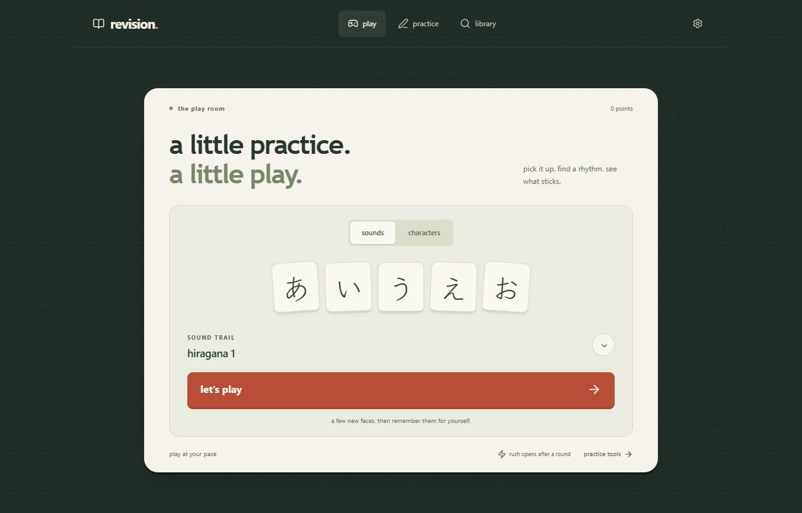

<p><a href="https://nihongo.okiso.net/"><picture>
  <source media="(prefers-color-scheme: dark)" srcset="https://raw.githubusercontent.com/okisooo/NihongoRevisionSuite/main/docs/media/practice-sleeve-dark.gif">
  
</picture></a></p>

<div align="center">

offline Japanese learning, a few minutes at a time. read, recall, write and listen — then come back to what needs another try.

**[open the web app](https://nihongo.okiso.net/)** · [install on your device](#take-it-offline) · [run from source](#run-from-source)

phone & desktop · installable web app · no account required

</div>

[](https://nihongo.okiso.net/)

*the public web app with a fresh, zero-progress view. no personal study history is shown.*

## a small round, then another

1. **pick a set.** meet a few sounds or characters with the answers visible.
2. **try recalling them.** recall with the answers hidden, and revisit answers you needed help with.
3. **keep practicing.** use writing, listening and timed tools as you learn; saved progress lets you return later.

| work on | what is included |
| --- | --- |
| reading & recall | 28 phonetic-alphabet sets, 60 written-character stages, and saved skill progress |
| handwriting | guided stroke models and graded writing practice |
| listening | device speech and listening exercises |
| grammar & lookup | 30 grammar lessons, sentence reading and a reference library |
| keeping progress | unfinished-round recovery and JSON backup import/export in settings |

## take it offline

open the app online and let its offline download finish first. then use **add to home screen** in Safari on iPhone, or the **install app** option in a supported Android or desktop browser. study content, stroke data and fonts are bundled for use after that first successful download.

listening needs an available Japanese speech voice; offline voice support varies by device. device speech services may have their own network behavior.

progress stays in this browser or native installation. there are no accounts or automatic cross-device sync. **export a backup in settings before clearing browser data**, or to transfer progress to another device. backup files contain your study records.

<details>
<summary>native wrappers and release status</summary>

the source includes an Electron desktop wrapper, Windows portable packaging and a Capacitor iOS target. no public GitHub Releases are currently published, and no App Store or Play Store release is offered here. native signing and real-device installation need separate verification.

</details>

## run from source

React 19, Vite 8 and JavaScript/JSX, with a progressive web app service worker. use Node.js 22 and the committed npm lockfile:

```sh
git clone https://github.com/okisooo/NihongoRevisionSuite.git
cd NihongoRevisionSuite
npm ci
npm run dev
```

`npm run build` generates `dist`. the web workflow runs tests and lint before publishing to GitHub Pages. Electron's `npm start` loads that built directory, so build first when using the desktop wrapper.

[round logic](src/play) · [practice tools](src/rush) · [study & backups](src/study) · [web deployment](docs/WEB-DEPLOYMENT.md) · [content review & known limits](docs/CONTENT-AUDIT.md)

stroke data comes from [AnimCJK](https://github.com/parsimonhi/animCJK), with the Arphic Public License and attribution in the [bundled notice](src/data/strokes.LICENSE.txt). [Klee One](public/licenses/klee-one.txt) and [Noto Sans JP](public/licenses/noto-sans-jp.txt) have separate SIL Open Font License notices. no top-level application-code license is declared; bundled content and assets retain their own terms. see the [distribution notes](docs/IOS.md#before-any-public-release). this is a practice aid with the limits recorded in the content review.

---

made by [OKISO](https://github.com/okisooo) — no.03 in the little tools. also building no.01 [Backdrop — AI desktop wallpapers](https://github.com/okisooo/backdrop), no.02 [Fleet — Windows AI usage tracking](https://github.com/okisooo/fleet), and a [music & art website](https://github.com/okisooo/site).
